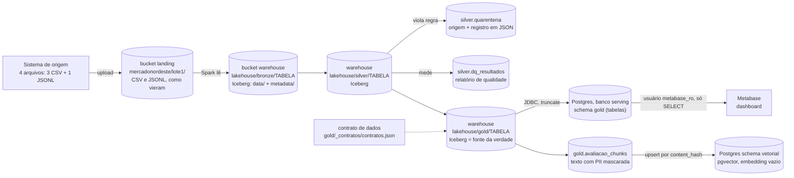

# Arquitetura de Coleta e Armazenamento de Dados

**Aluno:** José Nunes
**Curso:** MBA em BI e Big Data, UNIPÊ (turma 2026)
**Professor:** Wuldson Franco

Este repositório tem as atividades da disciplina:

| Atividade | Onde está |
|---|---|
| **Atividade Final: Arquitetura de coleta no Object Storage (Bronze, Silver e Gold)** | este README + pasta [`Atividade Final`](Atividade%20Final) |
| Atividade prática: storage com a API de cervejarias (Colab) | [`atividade_storage_breweries_Jose_Nunes.ipynb`](atividade_storage_breweries_Jose_Nunes.ipynb) |

---

# Atividade Final: Arquitetura de Coleta no Object Storage

Montei o pipeline do MercadoNordeste no meu computador e rodei as duas versões dos notebooks:

- **Versão Spark** (`Atividade Final/notebooks`): PySpark 3.5.3 em modo local, tabelas Iceberg no MinIO (catálogo `lake`).
- **Versão pandas** (`Atividade Final/notebooks pandas`): Parquet direto no MinIO, sem Iceberg. Rodei ela também porque alguns experimentos só existem nela (a "pasta" no object storage, o versionamento do bucket, os gates e o contrato de dados).

Serviços no Docker: MinIO, Postgres 16 com pgvector e Metabase v0.55. Python 3.11 e Java 17.

## Parte 1: Arquitetura

| Etapa | Onde fica | Formato | Quem escreve | Quem lê |
|---|---|---|---|---|
| Landing | bucket `landing`, prefixo `mercadonordeste/lote1/` | CSV (clientes, produtos, avaliações) e JSONL (pedidos) | o sistema de origem (no laboratório, o upload do notebook com o usuário admin do MinIO) | só o job de ingestão da Bronze |
| Bronze | bucket `warehouse`, `lakehouse/bronze/<tabela>` | Iceberg (Parquet em `data/` + `metadata/`). Na versão pandas: `bronze/<tabela>/lote1/part-0000.parquet` | o pipeline (Spark) | o job da Silver e quem audita a origem |
| Silver | `warehouse/lakehouse/silver/<tabela>` + `silver.quarentena` + `silver.dq_resultados` | Iceberg | o pipeline | o job da Gold e a equipe de dados |
| Gold | `warehouse/lakehouse/gold/<tabela>` e o contrato em `gold/_contratos/` | Iceberg (Parquet na versão pandas) e JSON | o pipeline, **só se passar nos gates** | a carga para o Postgres e os chunks |
| Serving | Postgres, banco `serving`, schema `gold` | tabela SQL | usuário `aula` (dono, usado pelo pipeline) | Metabase com `metabase_ro` (somente leitura) |
| Vetorial | Postgres, schema `vetorial` | tabela com coluna `vector(384)` | o pipeline (`sync_to_pgvector`) | o próximo módulo (embeddings e busca) |

**O que entra, o que sai e qual a regra principal**

- **Landing.** Entram os 4 arquivos do lote (`pedidos.jsonl` tem 7.601.232 bytes). Saem os mesmos arquivos, sem mudar nada. Regra: guardar exatamente como chegou.
- **Bronze.** Entra a landing. Saem 4 tabelas (clientes 5.000, produtos 200, pedidos 30.150, avaliações 6.489) com `_ingest_ts`, `_source_file` e `_batch_id`. Regra: não limpar nada e não duplicar ao reexecutar.
- **Silver.** Entra toda a Bronze. Saem clientes 5.000, produtos 197, pedidos 29.960, itens 50.030, avaliações 6.464, e 68 registros na quarentena. Regra: entrada = Silver + quarentena. Nada some sem motivo.
- **Gold.** Entra a Silver. Saem `vendas_diarias`, `clientes_360` e `avaliacoes_resumo`, com grão e dono definidos. Regra: só publica se todos os gates passarem.
- **Serving e Metabase.** Entra a Gold. Saem tabelas no Postgres e o dashboard. Regra: o Postgres é cópia, a fonte da verdade continua no lake. Quem consulta só lê.

## Parte 2: Evidências de que roda

Todos os notebooks estão executados, com as saídas gravadas. Eles abrem no Colab pelo GitHub (o Colab não acessa o MinIO e o Postgres do meu computador, então as saídas são as da execução local).

| O que foi pedido | Onde ver | Resultado |
|---|---|---|
| Objetos da landing e do warehouse | `notebooks/01_bronze` (passo 2) e `notebooks pandas/01_bronze_local_pandas` (passos 1 e 4) | 4 arquivos na landing; na versão pandas, 1 Parquet por tabela em `warehouse/bronze/<tabela>/lote1/` |
| Experimento da "pasta" (prefixos e renomear) | `notebooks pandas/01_bronze_local_pandas`, experimento do passo 1 | `Prefixos: ['mercadonordeste/lote1/']` e `Depois do 'renomear': ['teste/b.txt']` (renomear = copiar + apagar) |
| Contagem por tabela e idempotência | `notebooks/01_bronze` (passos 3 e 4) | `{'clientes': 5000, 'produtos': 200, 'pedidos': 30150, 'avaliacoes': 6489}` e `30150 -> 30150 \| idempotente: True`. Na versão pandas: `Objetos: 1 -> 1` |
| Resumo da construção, quarentena por origem e reconciliação | `notebooks/02_silver` | quarentena: 40 `pedidos_cliente_orfao`, 25 `avaliacoes_nota_invalida`, 3 `produtos`. Reconciliação: `30000 = 29960 (silver) + 40 (quarentena) -> True` |
| Relatório do DQ e tabela `dq_resultados` | `notebooks/02_silver`, célula do DQ | 8 regras: 7 OK e 1 AVISO (`not_null(email)`, 270 falhas, 5,4%) gravadas em `lake.silver.dq_resultados` |
| Erro simulado e recuperação | `notebooks/02_silver` (Iceberg) e `notebooks pandas/02_silver_local_pandas` (versionamento do bucket) | `50105 -> 43886 (sumiram 6219)`, versão antiga com 50.105 linhas, `linhas depois do rollback: 50105` |
| Gates todos OK, três tabelas publicadas e contrato | `notebooks pandas/03_gold_local_pandas` (passos 4 e 5) | `OK 17` (17 de 17), as 3 tabelas em `gold/` e `contrato publicado em s3://warehouse/gold/_contratos/contratos.json` |
| Tabelas gold no Postgres e pergunta no Metabase | `notebooks/03_gold` e [`03 Gold - Jose Nunes.ipynb`](Atividade%20Final/03%20Gold%20-%20Jose%20Nunes.ipynb) | `gold.vendas_diarias` 30.129, `gold.clientes_360` 5.000, `gold.avaliacoes_resumo` 112 e o dashboard abaixo |

O Metabase lê o banco com o usuário `metabase_ro`. Teste feito com ele: `SELECT count(*) FROM gold.vendas_diarias` devolveu 30129; `DELETE FROM gold.vendas_diarias` deu `permission denied for table vendas_diarias`; `CREATE TABLE gold.teste` deu `permission denied for schema gold`.

**Ajustes que precisei fazer no meu ambiente**

1. **Python 3.11.** Com 3.12 no Windows o worker do Spark caía (`Python worker exited unexpectedly`).
2. **DQ da Silver.** Criar o DataFrame a partir de lista Python derrubava o worker (`Connection reset`). Troquei por pandas + Arrow; o relatório é o mesmo.
3. **Gate de pedidos da Gold pandas.** O gate `pedidos Gold = pedidos válidos Silver (22473)` deu ERRO e bloqueou a publicação. Investiguei: 187 pedidos válidos tinham **só** itens dos 3 produtos em quarentena (ids 55, 114 e 173). Sem item válido, eles não têm receita e não aparecem na `vendas_diarias`. Ajustei o gate para comparar com os pedidos que têm pelo menos 1 item válido e acrescentei uma linha que confere se esses 187 estão todos explicados pela quarentena de itens.
4. **`common/vetorial.py`.** O `03_gold` importa esse módulo, mas ele não estava no repositório da disciplina. Escrevi seguindo o contrato de `docker/initdb/01_init.sql`. Resultado: 6.464 chunks, 90 textos únicos, todos pendentes no pgvector.

## Parte 3: Perguntas

**1. Qual regra da Silver mandou mais registros para a quarentena e por quê?**

Na versão Spark foi a do **cliente inexistente**: 40 pedidos com `cliente_id` 999999, que não existe no cadastro de clientes (exemplos: pedidos 103054 e 104139). Depois vem a nota fora de 1 a 5 (25 avaliações) e o preço negativo (3 produtos: 55 com -418,73, 114 com -462,01 e 173 com -308,20). Um pedido sem cliente não pode ser atribuído a ninguém na `clientes_360`, por isso ele sai da Silver, mas fica guardado com o motivo.

Na versão pandas o maior grupo foi outro: **747 itens** (`itens_produto_inexistente`). Os 3 produtos com preço negativo foram para a quarentena, e todos os itens que vendiam esses produtos foram junto. Isso mostra como um erro pequeno no cadastro (3 produtos de 200) se espalha: virou 747 itens e deixou 187 pedidos sem nenhum item válido.

**2. Se a reconciliação não fechasse, o que você investigaria primeiro?**

Aconteceu duas vezes comigo. Na Gold do Spark, a receita deu R$ 40.310.963,52, contra R$ 40.817.199,93 somando os itens de todos os pedidos não cancelados da Silver. Na Gold pandas, o gate de pedidos parou em 22.473 contra 22.286.

O que fiz, e faria de novo, foi contar o que entra e o que sai em cada passo, procurando onde a linha some, principalmente nos **joins** e nos **filtros**. Nos dois casos a diferença estava no join com produtos: os itens dos 3 produtos em quarentena não têm par e saem do resultado. A diferença de R$ 506.236,41 é exatamente a receita desses itens. Quando a diferença é explicada pela quarentena, a conta fecha. Se não fosse, eu olharia em seguida duplicidade (pedidos repetidos inflam a receita; a Bronze tinha 150) e os status que entram na conta. Inclusive, as duas versões usam regras diferentes: a do Spark só exclui `cancelado`, a do pandas exclui `cancelado` e `devolvido`. Por isso o contrato precisa dizer qual é a regra.

**3. Que dado pessoal existe na sua arquitetura e como ele foi tratado?**

Existem `nome`, `email`, `cidade` e `estado` em clientes, o `cliente_id` (pseudônimo, liga à pessoa) e o comentário livre das avaliações, que pode trazer CPF, telefone ou e-mail.

- **Removido:** o e-mail não entra na Gold em nenhuma das versões. Na Silver, e-mail inválido virou NULL (270 clientes, regra em AVISO).
- **Mascarado:** na `clientes_360` da versão pandas o nome aparece como `A**** P******`. Nos chunks para IA, CPF, telefone e e-mail viram `[CPF]`, `[TELEFONE]` e `[EMAIL]` antes de qualquer embedding, e o `cliente_id` fica fora dos metadados.
- **Restrito:** o Metabase lê com `metabase_ro`, só com SELECT (testado acima). O `.env` com as senhas não vai para o GitHub.
- **Ponto que eu corrigiria:** na versão Spark, a `clientes_360` ainda leva o **nome completo** para o Postgres, e o Metabase consegue ver. Eu aplicaria a mesma máscara da versão pandas antes de publicar.

**4. O que você mudaria se o volume fosse 1.000 vezes maior?**

Hoje um lote tem uns 8 MB e 30 mil pedidos. Mil vezes mais seriam ~8 GB e 30 milhões de pedidos por lote.

1. **O catálogo primeiro.** O Hadoop catalog guarda o ponteiro da tabela em arquivos no próprio bucket e depende de renomear arquivos, o que o S3 não faz de forma atômica. Com vários jobs escrevendo ao mesmo tempo, dá conflito. Eu trocaria por um catálogo de verdade (REST, como Nessie ou Polaris, ou Glue/Hive). É barato de trocar e evita corromper tabela.
2. **O processamento.** `local[2]` com 2 GB não aguenta. Iria para um cluster Spark (ou Databricks/EMR), e a versão pandas sairia, porque ela carrega tudo na memória.
3. **Carga incremental e partição.** Hoje a Silver é reconstruída inteira a cada execução. Com esse volume eu particionaria por data e faria só o lote novo (MERGE no Iceberg). Também faria manutenção: compactar arquivos pequenos e expirar snapshots antigos. Só a `bronze.pedidos` já tem 7 versões de metadata depois de poucas execuções.
4. **O formato eu manteria** (Parquet + Iceberg), porque ele já foi feito para esse volume. O Postgres continuaria recebendo só agregados da Gold, nunca o detalhe.

## Como reproduzir

1. `docker compose up -d` na pasta `Atividade Final/docker` (copie `.env.example` para `.env` e preencha).
2. Ambiente Python 3.11: `pip install -r requirements.txt`.
3. Rodar, em ordem: `01_bronze`, `02_silver`, `03_gold` (ou as versões pandas).
4. Metabase em `http://localhost:3000`, banco `serving`, host `postgres`, usuário `metabase_ro`.
